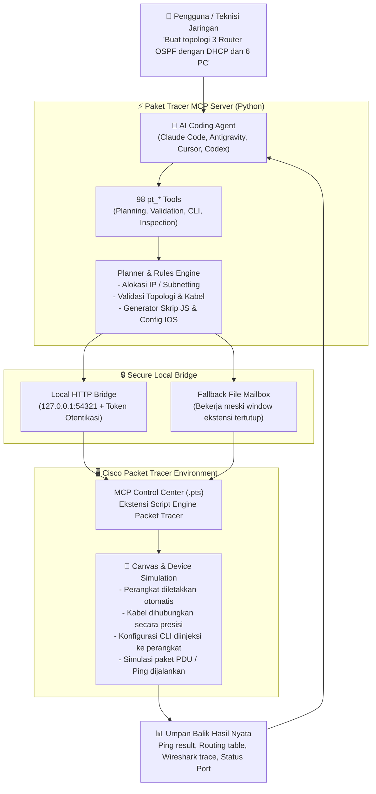
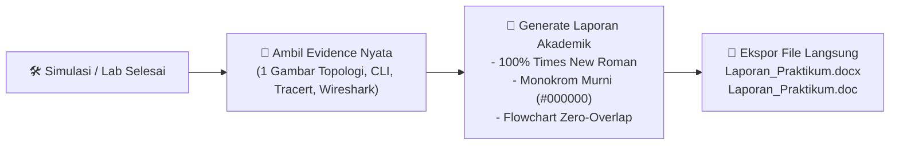

<div align="center">


# 🚀 Cisco Packet Tracer MCP Server
### Kendalikan, Bangun, dan Analisis Jaringan Cisco Packet Tracer Secara Otomatis Menggunakan AI

**Jelaskan kebutuhan jaringan Anda dalam bahasa sehari-hari. AI akan merancang topologi, memvalidasi aturan teknis, menyusun konfigurasi IOS CLI, membangun topologi secara langsung (*live deploy*) di Cisco Packet Tracer, hingga memverifikasi koneksi dengan pengujian ping dan capture paket!**

<sub>Pasang otomatis melalui asisten AI Anda: <i>"Install the Packet Tracer MCP from https://github.com/Masmas99/MCP-Packet-Tracer.git and set everything up for me."</i></sub>

<br/>

[](https://github.com/Masmas99/MCP-Packet-Tracer)
[](https://python.org)
[-00B4D8?style=flat-square)](https://modelcontextprotocol.io)
[](https://www.netacad.com/courses/packet-tracer)
[](LICENSE)

<br/>

<table>
<tr>
<td align="center"><strong>98</strong><br/><sub>Alat MCP (Tools)</sub></td>
<td align="center"><strong>6</strong><br/><sub>Resource MCP</sub></td>
<td align="center"><strong>3</strong><br/><sub>Prompt Pintar</sub></td>
<td align="center"><strong>74+</strong><br/><sub>Model Perangkat</sub></td>
<td align="center"><strong>150+</strong><br/><sub>Modul Perangkat</sub></td>
<td align="center"><strong>15</strong><br/><sub>Tipe Kabel Jaringan</sub></td>
</tr>
</table>

</div>

---

## 📺 Cuplikan Demonstrasi (*Showcase*)

<p align="center">
  
</p>
<p align="center"><em>Dari teks prompt bahasa manusia langsung menjadi topologi aktif yang terkonfigurasi di Cisco Packet Tracer secara real-time.</em></p>

<table>
<tr>
<td width="50%">
<p align="center"></p>
<p align="center"><strong>Topologi Otomatis</strong><br/><sub>3 Router dengan dynamic routing OSPF, DHCP pool, dan 6 PC yang dibuat dan dirapikan otomatis oleh AI.</sub></p>
</td>
<td width="50%">
<p align="center"></p>
<p align="center"><strong>Sintaks IOS CLI Asli</strong><br/><sub>Skrip konfigurasi Cisco IOS yang digenerate secara sintaksis dan di-push langsung ke terminal konsol router/switch.</sub></p>
</td>
</tr>
</table>

---

## 🧠 Cara Kerja Sistem (*System Architecture*)

Sistem ini bekerja dengan menghubungkan **Model Context Protocol (MCP)** dari AI Coding Agent (seperti Claude Code, Cursor, Antigravity, OpenCode, atau Codex) ke **Cisco Packet Tracer** melalui jembatan komunikasi lokal yang aman (*authenticated loopback HTTP bridge* dan *fallback file mailbox*):



---

## ✨ Fitur-Fitur Utama (*Key Capabilities*)

| Kategori | Deskripsi Kemampuan | Contoh Tools Utama |
| :--- | :--- | :--- |
| 🏗️ **Pembangunan Topologi** | Merancang dari nol, auto-layout rapi, validasi kabel, hingga eksekusi live ke kanvas Packet Tracer. | `pt_full_build`, `pt_plan_topology`, `pt_validate_plan`, `pt_live_deploy` |
| 🌐 **Subnetting & Addressing** | Alokasi subnet /24, /30 point-to-point, DHCP Server di Router atau Server-PT, serta dukungan IPv6 Dual Stack. | `pt_configure_dhcp_server`, `pt_host_ip_config` |
| 🔀 **Routing Protokol** | Konfigurasi Static Route (Floating backup), OSPF multi-area, EIGRP, RIP, BGP, HSRP Redundancy, dan QoS. | `pt_apply_hsrp`, `pt_apply_bgp`, `pt_apply_qos`, `pt_read_routes` |
| ⚡ **Switching & VLAN** | VLAN Access/Trunk 802.1Q, Router-on-a-Stick, STP (Spanning Tree), Port Security, EtherChannel, dan Wi-Fi Access Point. | `pt_apply_vlan`, `pt_apply_stp`, `pt_apply_port_security`, `pt_apply_etherchannel` |
| 📞 **VoIP / IP Telephony** | Cisco CallManager Express (CME) pada router 2811 dengan registrasi IP Phone (Cisco 7960) dan dial-peer. | `pt_apply_voice` |
| 🛡️ **Keamanan & Firewall** | Standard & Extended ACL, Dynamic/Static NAT, Hardening perangkat (SSH, secret, banner), dan Audit Keamanan live. | `pt_apply_acl`, `pt_apply_nat`, `pt_apply_hardening`, `pt_audit_security` |
| 💻 **Interaksi Terminal** | Mengetik langsung di CLI router/switch, Command Prompt PC (`ping`, `tracert`), browser web, dan mail client. | `pt_cli`, `pt_host_command`, `pt_web_browser`, `pt_server_*` |
| 🔍 **Diagnostik & Forensik** | Inspeksi tabel rute, status OSPF neighbor, ARP cache, MAC table, DHCP leases, dan capture Wireshark Packet Tracer. | `pt_verify_connectivity`, `pt_health_check`, `pt_diff`, `pt_inspect_ports` |
| 📄 **Pelaporan Formal Otomatis** | Ekspor laporan teknis rapi format `.docx` dan `.doc` dengan tipografi Times New Roman murni, diagram, dan tabel. | Skill `formal-report-generator` |

---

## 🛠️ Panduan Instalasi (*Installation Guide*)

### Prasyarat Sistem:
- **Cisco Packet Tracer**: Versi **8.2**, **8.2.2**, **9.0**, atau **9.0.1** (Windows, macOS, atau Linux).
- **Python**: Versi **3.11+** atau manajer paket cepat **`uv`**.

---

### Cara 1: Instalasi Otomatis via AI Agent (Paling Mudah)
Buka terminal AI Coding Agent Anda (Claude Code, Antigravity, Cursor, Codex, dll.) lalu cukup ketikkan perintah:

```text
Install the Packet Tracer MCP from https://github.com/Masmas99/MCP-Packet-Tracer.git and set everything up for me.
```

AI akan mendeteksi sistem operasi Anda, mengunduh repositori, menginstal server MCP dan dependensi Python, serta menempatkan ekstensi Packet Tracer di folder yang tepat.

---

### Cara 2: Instalasi Manual (Langkah demi Langkah)

#### 1. Pasang Manajer Paket `uv`
`uv` menyediakan runtime Python independen tanpa mengganggu instalasi sistem:
* **Windows (PowerShell)**:
  ```powershell
  powershell -ExecutionPolicy ByPass -c "irm https://astral.sh/uv/install.ps1 | iex"
  ```
* **macOS / Linux**:
  ```bash
  curl -LsSf https://astral.sh/uv/install.sh | sh
  ```

#### 2. Kloning Repositori
```bash
git clone https://github.com/Masmas99/MCP-Packet-Tracer.git
cd MCP-Packet-Tracer
```

#### 3. Daftarkan Server MCP ke Client Anda
* **Untuk Claude Code (Windows PowerShell)**:
  ```powershell
  claude mcp add --scope user --transport stdio packet-tracer "--" uvx --from . packet-tracer-mcp --stdio
  ```
* **Untuk Claude Code (macOS / Linux)**:
  ```bash
  claude mcp add --scope user --transport stdio packet-tracer -- uvx --from . packet-tracer-mcp --stdio
  ```
* **Untuk Antigravity / Cursor / VSCode (`mcp_config.json`)**:
  ```json
  {
    "mcpServers": {
      "packet-tracer": {
        "command": "uvx",
        "args": ["--from", "C:/laragon/www/mcp-to-cisco", "packet-tracer-mcp", "--stdio"]
      }
    }
  }
  ```

#### 4. Pasang Ekstensi Packet Tracer (`MCP-Control-Center.pts`)
1. Salin file **`MCP-Control-Center.pts`** yang ada di repositori ini.
2. Buka folder ekstensi Packet Tracer Anda:
   - **Windows**: `C:\Program Files\Cisco Packet Tracer <versi>\extensions\MCPControlCenter\` (atau di `%USERPROFILE%\Cisco Packet Tracer <versi>\extensions\MCPControlCenter\`).
   - **macOS**: `/Applications/Cisco Packet Tracer <versi>.app/Contents/extensions/MCPControlCenter/`.
   - **Linux**: Buka menu **Extensions $\rightarrow$ Scripting $\rightarrow$ Configure PT Script Modules $\rightarrow$ Add...** lalu pilih file `MCP-Control-Center.pts`.
3. Saat Packet Tracer dibuka kembali dan muncul dialog: *"Detected a new script module... enable?"*, klik **Yes**.

<p align="center">
  
</p>

---

## 🎯 Contoh Perintah yang Siap Dijalankan (*Real-world Prompts*)

Berikut adalah beberapa contoh instruksi dalam Bahasa Indonesia yang bisa Anda berikan langsung ke AI:

### 1. Membangun Jaringan LAN dengan Dynamic Routing (OSPF)
> *"Buat topologi 3 Router Cisco 2911 membentuk segitiga redundansi. Hubungkan tiap router dengan kabel serial/gigabit subnet /30. Pasang 1 Switch dan 2 PC di belakang masing-masing router. Aktifkan OSPF area 0 pada semua router dan buat DHCP pool di setiap LAN. Setelah selesai, lakukan tes ping antar PC untuk membuktikan konektivitas."*

### 2. Konfigurasi Inter-VLAN Routing (Router-on-a-Stick) & ACL Firewall
> *"Buat topologi Router-on-a-Stick menggunakan 1 Router 2911 dan 1 Switch 2960. Buat VLAN 10 untuk Keuangan dan VLAN 20 untuk Server Web. Aktifkan trunk 802.1Q dan buat sub-interface G0/0.10 serta G0/0.20. Terapkan Extended ACL di router untuk memblokir akses HTTP dari VLAN 10 ke Server Web di VLAN 20, lalu verifikasi dengan capture paket Wireshark di Packet Tracer."*

### 3. Troubleshooting & Analisis Failover Rute (Tracert)
> *"Simulasikan jalur Jakarta ke Surabaya melalui jalur utama Router 2 dan jalur cadangan Router 4. Jalankan perintah tracert dari PC Jakarta ke PC Surabaya. Kemudian putuskan interface jalur utama (shutdown), jalankan tracert kembali, dan jelaskan mengapa rute otomatis beralih ke jalur cadangan."*

---

## 📊 Alur Kerja Pelaporan Otomatis (*Formal Report Skill*)

Repositori ini telah dilengkapi dengan skill bawaan **`formal-report-generator`** yang menjamin setiap praktikum atau simulasi langsung menghasilkan laporan rapi dalam format Word (`.docx` dan `.doc`):



---

## 📂 Struktur Repositori

```text
MCP-Packet-Tracer/
├── .agents/                        # Konfigurasi skill & aturan agen otomatis
│   ├── rules/auto_report.md        # Aturan wajib pelaporan rapi dan monokrom
│   └── skills/                     # Skill pelaporan formal bawaan workspace
├── demo/                           # Aset visual, banner, screenshot, dan gif demo
├── docs/                           # Dokumentasi teknis lengkap dan panduan tool
├── EXTENSION/                      # Source code ekstensi JavaScript Packet Tracer
│   ├── script-engine/main.js       # Runtime pengontrol API internal Packet Tracer
│   └── webview/                    # Tampilan antarmuka HTML/JS Control Center
├── skills/                         # Skill resmi formal-report-generator
│   └── formal-report-generator/    # Skrip pembantu dokumen Word & template
├── src/packet_tracer_mcp/          # Inti server Python Model Context Protocol
│   ├── adapters/mcp/tools/         # Implementasi 98 tools pt_* (ACL, OSPF, VLAN, dll.)
│   ├── domain/                     # Logika perencanaan topologi & aturan validasi
│   └── infrastructure/             # Jembatan HTTP loopback & eksekutor perintah
├── tests/                          # Rangkaian pengujian unit test dan regresi
├── AGENTS.md                       # Panduan teknis perilaku agen coding AI
├── MCP-Control-Center.pts          # Ekstensi siap pakai untuk Cisco Packet Tracer
├── pyproject.toml                  # Konfigurasi dependensi project Python
└── README.md                       # Dokumentasi utama proyek
```

---

## 🔒 Keamanan (*Security*)

- **Loopback Only**: Server jembatan komunikasi hanya mengikat ke alamat lokal `127.0.0.1` dan menolak seluruh koneksi jaringan eksternal.
- **Token Otentikasi Acak**: Setiap sesi komunikasi dilindungi dengan token acak (*per-machine bridge token*) yang disimpan di direktori terproteksi `%LOCALAPPDATA%` pengguna.
- **Tanpa f-string JavaScript Mentah**: Seluruh argumen perintah diproses melalui enkapsulasi JSON yang ketat untuk mencegah injeksi kode (*code injection*) pada Script Engine Cisco Packet Tracer.

---

## 🤝 Kontribusi

Kontribusi kode, penambahan model perangkat baru, perbaikan bug, atau penyempurnaan dokumentasi sangat disambut baik!
1. Fork repositori ini ke akun Anda: `https://github.com/Masmas99/MCP-Packet-Tracer.git`
2. Buat branch fitur baru (`git checkout -b feature/FiturBaru`)
3. Jalankan pengujian: `python -m pytest`
4. Commit perubahan Anda (`git commit -m "feat: Menambahkan fitur X"`)
5. Push ke branch Anda (`git push origin feature/FiturBaru`)
6. Buat **Pull Request** baru.

---

## 📄 Lisensi

Proyek ini dilisensikan di bawah lisensi terbuka [MIT License](LICENSE). Anda bebas menggunakannya untuk keperluan riset, tugas kuliah, praktikum laboratorium, maupun pengembangan otomasi jaringan korporat.

<div align="center">
<sub>Dikelola dengan ❤️ oleh <a href="https://github.com/Masmas99">Masmas99</a> • Dikembangkan di atas protokol standar <a href="https://modelcontextprotocol.io">Model Context Protocol (MCP)</a></sub>
</div>
